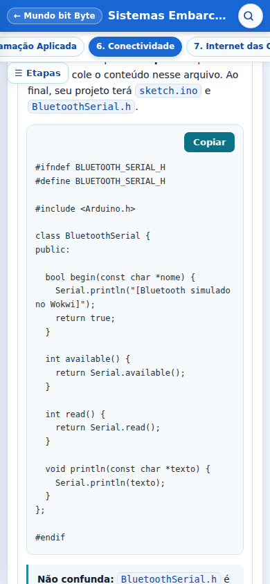
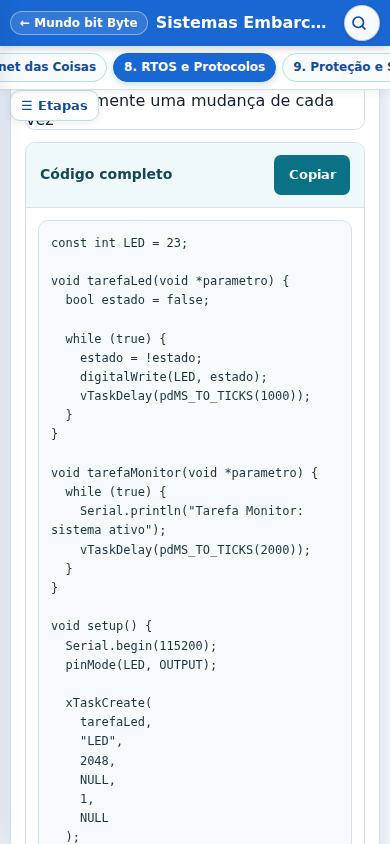
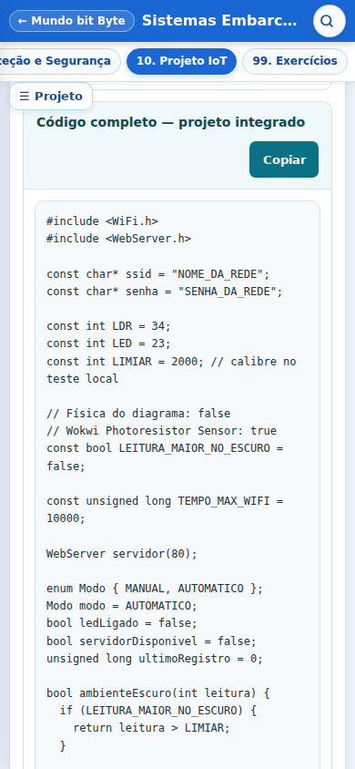
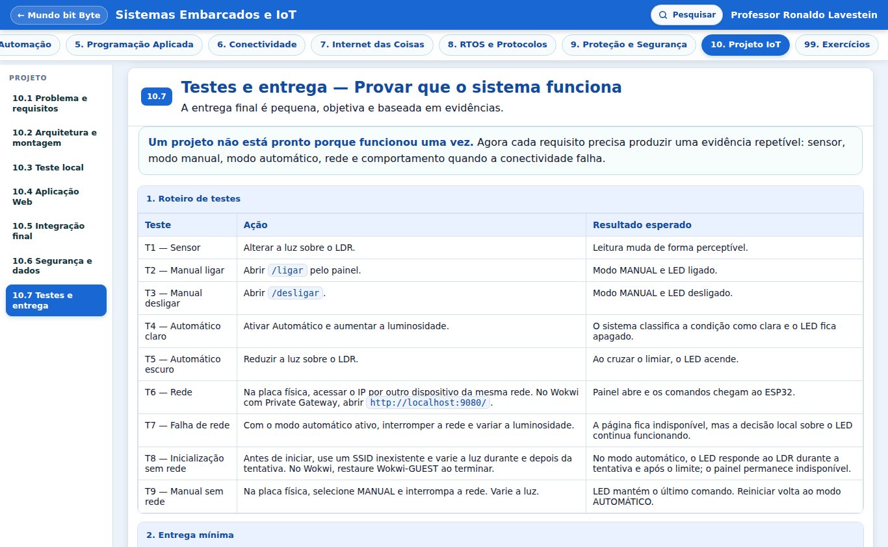

# Auditoria dos módulos 6 a 10 — Sistemas Embarcados e IoT

Data: 27/10/2026. Repositório: `mundobitbyte/site`.

## A. Diagnóstico inicial

A base já continha as melhorias dos PRs 196–203. Não foi reconstruída. O percurso de entrada e saída, LDR, HC-SR04, servo, funções e textos dos módulos 1–5 foi consultado para conferir pré-requisitos. As primeiras inspeções incluíram o site público e uma varredura local em três larguras.

| Módulo | Problema concreto encontrado | Correção aplicada |
|---|---|---|
| 6 — Conectividade | Comandos apareciam na explicação original e em outro cartão; a instrução para passar ao hardware não mandava remover o cabeçalho simulado. | Leituras incorporadas ao momento original; orientação para remover a aba `BluetoothSerial.h`, que poderia ocultar a biblioteca real. Esclarecidos modelos atuais do Wokwi e entrada opcional para salvar. |
| 7 — IoT | Recapitulações repetiam o contexto e os checkpoints; exemplos por área deixavam comunicação e aplicação implícitas. | Um caso de vazamento resolvido como fluxo completo, incluindo falha de rede; transferência aos demais casos sem novo circuito obrigatório. |
| 8 — RTOS e Protocolos | Os seis argumentos de criação de tarefa eram apenas enumerados. Configuração do LCD e escolha da biblioteca não eram suficientemente reproduzíveis. | Argumentos explicados pelos valores reais, pilha em bytes no ESP32, prioridade versus período, ciclo completo do LED; configuração `pins: i2c`, biblioteca identificada, reinício do scanner e contraste do LCD. |
| 9 — Segurança | Faltavam detalhes de validação do certificado, cuidado com logs e limites de comandos GET. | Complementos junto dos conceitos existentes; exercício de permissões de observador e operador. LGPD apresentada por extenso. |
| 10 — Projeto | Automação só começava após a tentativa Wi-Fi; o programa integrado não imprimia as leituras prometidas. A entrega exigia painel também de quem tinha somente Wokwi gratuito. | Primeira decisão local antes da rede e atualização durante a espera; registros periódicos no Serial; entrega e testes separados por capacidade real do ambiente. |

Na navegação, âncoras internas podiam deixar o painel de destino oculto; trocar etapas com `replaceState` não notificava os observadores de âncora do Meu MbB. Ambos os comportamentos foram corrigidos apenas nos cinco scripts desses módulos.

## B. Correções realizadas

- Sete leituras do módulo 6 passaram a ocupar a explicação correspondente, preservando os comandos, os programas e os botões.
- Cinco leituras dos módulos 8 e 10 foram incorporadas ao próprio cartão do programa.
- Vinte e dois cartões de recapitulação de fórmula repetida deram lugar a sete desafios opcionais distintos. Os conhecimentos essenciais continuam nos conceitos, práticas e checkpoints existentes.
- O projeto identifica leitura bruta do ADC, calibração com números observados, igualdade com o limiar e possível alternância perto do limite. Explica a inversão do divisor físico em relação ao sensor Wokwi.
- Foram acrescentados testes de inicialização sem rede e perda de rede no modo manual. Reiniciar volta ao modo automático; não há promessa de recuperação automática da conexão.
- A revisão complementar do projeto ficou alcançável a partir da entrega. A central 99 ganhou ligação direta aos testes, preservando a organização principal de 80 horas e módulos 1–9.

## C. Revisão pedagógica circular e em espiral

A sequência mantém a necessidade inicial de comunicar o LED; depois analisa o sistema IoT, organiza tarefas e interfaces, examina acesso e dados e integra LDR, LED e Web. O projeto reaproveita o GPIO 23 e usa GPIO 34/ADC1 para o sensor. RTOS, LCD e CAN continuam como conhecimentos com finalidade própria, sem inclusão artificial no integrador.

A baliza de estudante iniciante foi uma leitura crítica, não um teste com estudante real. Foram conferidos necessidade, instrução, resultado, erro comum e explicação dos comandos. Nenhuma avaliação com alunos reais é alegada.

## D. Revisão técnica

Os sketches anteriores permanecem idênticos; a mudança de comportamento está no `b10-final`. Também foram preservados os circuitos e as imagens aprovadas.

Conferências: Bluetooth Classic/SPP versus interface simulada; ESP32 original versus outras famílias; GPIOs 3,3 V; LDR e divisor; ADC1; scanner e LCD I2C; pull-ups e conversão bidirecional para 5 V; UART versus RS-232; controlador/transceptor e terminações CAN; HTTP/TCP/IP/Wi-Fi; mDNS e túnel. A orientação de SSH não manda aceitar uma chave sem verificar a identidade.

O controle local recebe atualizações na espera inicial de rede, com `delay(500)`. Não é uma garantia de tempo real. No loop, o Serial é registrado a cada 500 ms usando `millis()`. No modo manual sem rede, o estado anterior é mantido; não foi inventada uma política de retorno automático.

## E. Revisão visual

Mantidos códigos em fundo claro, texto escuro, fonte monoespaçada, indentação e Copiar. As tabelas têm contenção e rolagem local; a tabela de entrega do projeto não fica recortada pelo cartão. Preservada a ampliação seletiva global. Âncoras de código recebem margem para os cabeçalhos fixos.

As leituras ficam junto do programa, com menos cartões e menos introduções repetidas. As verificações de layout exigiram renderização real, não apenas existência de `@media`.

## F. Testes realizados e limites

| Tipo | Execução e resultado |
|---|---|
| Estáticos | Sintaxe de sete scripts; `git diff --check`; IDs únicos e recursos locais das sete páginas; comparação dos blocos anteriores; índices de pesquisa e visitas atualizados pelo gerador existente. |
| Compilação ESP32 | **14 sketches/variantes aprovados**, Arduino CLI **1.5.1**, Arduino-ESP32 **3.3.12**, FQBN `esp32:esp32:esp32`. Inclui Bluetooth real, cabeçalho simulado, Wi-Fi e cliente HTTP Wokwi, RTOS, scanner, LCD, teste local e integrador. [SHA-256 e resumos](compilacao.json). |
| Lógica automatizada | O texto real do integrador foi compilado e executado em C++ no computador com interfaces simuladas: duas orientações do LDR, igualdade do limiar, mudança do sensor durante a espera, modos, falha inicial, perda de rede, quatro rotas e HTML. Isso não emula ESP32 nem executa TCP/HTTP real. |
| Navegador real | Chromium, **390×844, 768×844 e 1366×844**. **105 combinações** de páginas/etapas/larguras; **48 cópias** iguais ao texto do código; três entradas por âncora interna; fragmento inválido; três pesquisas públicas chegando ao destino. Sem erros JavaScript ou recursos locais HTTP 4xx/5xx na varredura. [Resultados](navegador.json). |
| Ampliação | **11 aberturas** de circuitos e tabelas, com ampliar, reduzir e fechar, nas três larguras. Tabelas que cabem no desktop não foram obrigadas a receber botão. [Resultados](visuais.json). |
| Meu MbB | **29 testes existentes aprovados**. Interface dos cinco módulos exercitada com conta fictícia em memória: visitas, troca de etapas, favoritos, conclusão e duas anotações. Nenhuma gravação real no Firebase. [Resultados](meu-mbb-simulado.json). |
| Wokwi | Sketch RTOS do módulo 8 executado em ESP32 DevKit v1, LED/resistor 220 Ω no D23/GPIO 23. Foram observados LED aceso/apagado e seis mensagens da tarefa Monitor em cerca de **10,8 segundos simulados**. A velocidade de simulação estava em 3%; não se usou tempo de relógio como tempo simulado. Sem medição instrumental da frequência do LED. [Captura](wokwi-rtos.jpg). |
| Hardware físico | **Não executado**: não havia ESP32 físico disponível. |

A biblioteca LiquidCrystal I2C 1.1.2, de Frank de Brabander, declara arquitetura AVR em seus metadados e emite esse aviso no compilador. O sketch compilou para ESP32; isso não substitui teste do LCD físico e da adaptação elétrica.

Não foram executados rádio Bluetooth real, mDNS em LAN real, túnel até uma placa, servidor Web acessado em ESP32 físico, Private IoT Gateway pago ou autenticação/persistência reais do Firebase. Somente a prática RTOS foi efetivamente simulada no Wokwi nesta auditoria.

Scripts reproduzíveis: [navegador](../../../tools/seiot-validacao/navegador.cjs), [lógica do integrador](../../../tools/seiot-validacao/logica-projeto.py) e [Meu MbB simulado](../../../tools/seiot-validacao/meu-mbb-simulado.cjs). Os testes de navegador requerem Playwright e um Chromium disponível; não foram adicionados às dependências de produção.

## G. Preservação

IDs e versões de progresso, destinos antigos e status das unidades foram preservados. O catálogo mudou somente nos campos gerados de texto e tópicos de pesquisa das seis páginas editadas com conteúdo indexado. Menu completo com onze opções foi conferido em cada largura. Exercícios, código auxiliar e Copiar continuam presentes.

Nenhuma alteração em Firebase, regras, credenciais, dados de usuários, Academia, Home, demais cursos ou imagens aprovadas. A conta em memória foi interceptada antes de carregar o código de conta real; requisições externas foram bloqueadas nesse ensaio.

## H. Branch, PR e publicação

- Base: `8781d5df27582c3c7295b2cd4762c576d94721b8`.
- Branch: `auditoria-seiot-6a10-20261027`.
- [Pull Request #211](https://github.com/mundobitbyte/site/pull/211).
- Commit de implementação no GitHub: `328a14653d79a7e3e573293ac97072e36437b5f8`.
- Árvore do código conferida: `35b07d97c3af1e1009be2d76ec60df4b6f30f151`, idêntica à árvore local validada.

Este documento registra a auditoria anterior à integração. O resultado das verificações do GitHub, o SHA de integração e a conferência posterior na hospedagem são informados no PR e na resposta final. Merge e disponibilização pública são verificações distintas.

## I. Pendências reais

Testes físicos e integrações reais citados na seção F dependem dos equipamentos, da rede e de conta real. Não impedem a publicação destas correções didáticas e funcionais, mas impedem declarar o conjunto validado fisicamente. Não há teste com alunos reais nem avaliação formal com leitor de tela.

## Fontes primárias consultadas

- [Espressif — FreeRTOS e parâmetros de tarefas](https://docs.espressif.com/projects/esp-idf/en/stable/esp32/api-reference/system/freertos_idf.html).
- [Espressif — ADC Arduino-ESP32](https://docs.espressif.com/projects/arduino-esp32/en/latest/api/adc.html).
- [Espressif — Wi-Fi Arduino-ESP32](https://docs.espressif.com/projects/arduino-esp32/en/latest/api/wifi.html).
- [Espressif — controlador TWAI e transceptor](https://docs.espressif.com/projects/esp-idf/en/stable/esp32/api-reference/peripherals/twai.html).
- [Wokwi — Wi-Fi e gateways](https://docs.wokwi.com/guides/esp32-wifi), [LCD](https://docs.wokwi.com/parts/wokwi-lcd1602) e [fotoresistor](https://docs.wokwi.com/parts/wokwi-photoresistor-sensor).
- [TI — MAX3232](https://www.ti.com/product/MAX3232).
- [Planalto — Lei 13.709/2018](https://www.planalto.gov.br/ccivil_03/_ato2015-2018/2018/lei/l13709.htm).
- [localhost.run — comando SSH](https://localhost.run/docs/cli/) e [segurança](https://localhost.run/docs/security/).

## Amostras visuais

